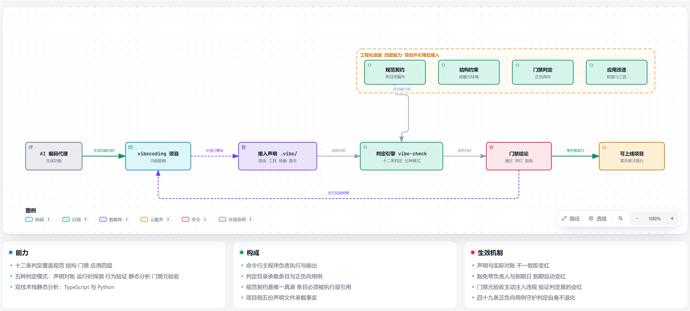
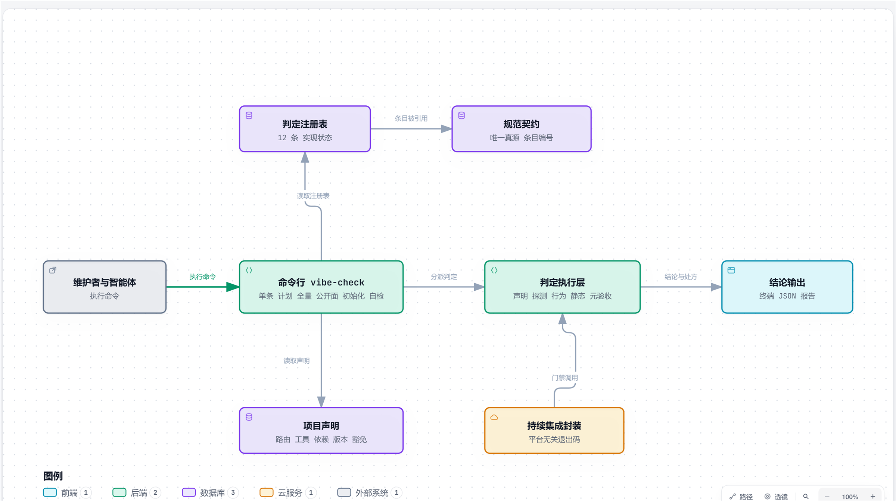

# vibe-foundation

**vibecoding 项目的工程化底座。**

<div align="center">

<p>
  <a href="https://github.com/jorinyang/vibe-foundation/releases"></a>
  <a href="https://nodejs.org/"></a>
  <a href="LICENSE"></a>
  <a href="#"></a>
  <a href="#"></a>
</p>



</div>

智能体把一个项目做到能跑，通常只要几个小时。接下来要上线，会撞上一串没有人系统检查过的问题：谁能访问哪个接口、数据库挂了流量还进不进来、配置少了一项会不会照样启动、密钥有没有混进仓库、换台机器装不装得上。

底座把检查项固定成十二条判定。每条判定对应一个具体场景，跑一遍就知道缺什么，缺的每一条都附修复步骤。

底座不生成业务代码。底座提供的是判定。

---

## 什么情况下会用到

- 功能已经做出来了，下一步要部署到服务器
- 要给外部系统或智能体开放一批调用接口
- 项目要交给第二个人接手，或者准备开源
- 上一个项目上线后出过权限漏、配置错、依赖丢、密钥进仓库

出现上面任意一条，把项目接到底座上跑一遍，缺什么会一条一条列出来，每条都附修复步骤。

---

## 当前状态

| 项 | 值 |
|---|---|
| 规范版本 | `0.11.0` |
| 判定条目 | 12 条 |
| 端到端用例 | 49 条（正向加负向） |
| 架构决策记录 | 4 份 |
| 真实项目改造结果 | 两个生产项目均为 11 通过、1 有期豁免、0 失败 |

---

## 十二条判定，每条对应一个真实场景

| 当出现这种情况 | 判定会做什么 |
|---|---|
| 项目入口文件越写越长，后面没人读得完 | 要求项目宪法不超过一百五十行；要求项目锁定的规范版本与实际一致 |
| 新加了一个接口却忘了登记，或者需要登录的接口被标成公开 | 比对接口清单与真实注册表，不一致就变红；公开接口必须写明为什么可以公开 |
| 甲用户能读到乙用户的订单 | 用两个真实身份验证越权被拒，并检查拒绝响应没有把数据带出来 |
| 对外暴露了一批工具，有一个没说明谁能调用 | 要求每个工具声明身份模式；工具的资源域必须在接口清单里出现过 |
| 服务身份拿着系统令牌，调用了应当由用户调用的工具 | 实测服务身份被拒、无身份被拒、用户身份可调用 |
| 数据库挂了，负载均衡还把流量打进来 | 要求存活检查与就绪检查分开；就绪检查必须带依赖明细 |
| 部署漏配了一个必需变量，服务用默认值悄悄跑起来 | 删掉必需变量重启服务，服务必须失败才算通过 |
| 代码引用了没写进依赖清单的包，换台机器装不上 | 扫源码比对运行依赖声明，超出声明即变红 |
| 项目没有依赖声明文件，看起来零依赖，实际是没声明 | 要求显式声明依赖；空声明也算声明 |
| 密钥被提交进仓库 | 接入现成扫描器，扫描命中即变红 |
| 改一个文件牵连全库，或者底层反过来依赖上层 | 建依赖图找环，比对项目声明的分层方向 |
| 担心判定是摆设，从来没有真的红过 | 主动注入一条违规，判定必须变红才算有效 |

判定只有三种结论：**通过、失败、有期豁免**。无法确认一律按失败处理。

---

## 架构



四层能力从项目外部接入，项目里只留一个指向底座的版本号。

```
                    L1 规范契约（唯一真源，条目带编号）
                              │ 只允许引用，不允许重述
        ┌──────────────┬──────┴───────┬──────────────┐
        ▼              ▼              ▼              ▼
   结构约束        门禁判定        应用改造         回流
   环境/分层      统一检查命令   权限/对外工具   改造日志→决策记录
        └──────────────┴──────────────┘
              全部由同一个 vibe-check 执行
```

前两层成本固定：做一次，所有项目复用。应用改造层随项目数增长，所以底座交付的是改造协议与判定，不是权限实现。

---

## 用法

```bash
# 第一次接触一个项目，先看还缺什么
vibe-check plan --project .

# 只想先修某一条，单独跑
vibe-check SPEC-OPS-01 --project /path/to/project

# 项目要进流水线，用门禁模式：退出码加可选报告文件
vibe-check all --project . --ci --sarif out.sarif

# 上级要问「有多少接口是公开的」，出公开面清单
vibe-check report-public --project .

# 项目刚接入，还没有 .vibe 目录
vibe-check init --project .

# 怀疑判定失灵，跑四十九条正负向用例
vibe-check --self-test
```

退出码固定：`0` 通过，`1` 失败，`2` 配置错误，`3` 判定崩溃。持续集成封装把退出码直接映射为流水线结果，`3` 不许当作成功。

---

## 真实项目效果

两个生产项目做了完整改造，架构完全不同，结论一致。

| 项目 | 技术形态 | 改造结果 |
|---|---|---|
| YSCOT（新加坡） | 单文件 Node 服务，手写路由 | 十一通过、一有期豁免、零失败 |
| sw-ims（香港） | TypeScript 多包仓库，框架路由，完整权限模型 | 十一通过、一有期豁免、零失败 |

两个项目的接口清单来源取法不同：YSCOT 由服务读取已部署源码输出，sw-ims 由框架钩子实时收集。

灵敏度实测，验证判定不是摆设：

| 测试 | 动作 | 结果 |
|---|---|---|
| 对外工具身份 | 把服务令牌换成有效用户令牌 | 判定变红 |
| 接口声明覆盖 | 从声明里删掉一条真实接口 | 判定变红 |
| 恢复配置 | 还原声明与令牌 | 两条判定恢复通过 |

另有九个真实项目做过只读验证，累计三十三次判定运行，零误报。

---

## 项目侧要放的文件

`.vibe/` 目录（`vibe-check init` 可生成模板）：

| 文件 | 作用 |
|---|---|
| `ref.json` | 锁定的底座版本 |
| `config.json` | 路由来源、服务启动方式、各类探测配置 |
| `routes.json` | 接口清单：公开接口带理由，受保护接口带资源、动作与主体 |
| `routes.actual.json` | 实际接口表（文件模式时使用，必须标注来源可信度） |
| `mcp-tools.json` | 对外工具清单：身份模式与资源域 |
| `runtime-deps.json` | 运行期依赖清单 |
| `override/<ID>.md` | 有期限的豁免 |

---

## 目录

```
bin/vibe-check.mjs   命令行：单条 / 计划 / 全量 / 公开面 / 初始化 / 自检
checks/              判定目录（每条：meta / positive / negative / fix）
spec/spec.json       规范契约唯一真源
spec/build-index.mjs 反向索引生成与死条款检测
ci/                  平台无关门禁封装
test/smoke.mjs       四十九条端到端用例
test/guard.mjs       防退化检查
test/setup-probe.mjs 真实项目只读探测配置生成
docs/images/         主视觉与架构图
```

---

## 开发

```bash
npm run build-spec   # 重新生成反向索引，检测死条款
npm test             # 防退化检查加全部端到端用例
```

改判定必须同时补正向用例与负向用例，否则自检变红。

---

## 设计文档

分层设计、判定规范、任务拆解与四份架构决策记录维护在项目外的知识库中。仓库只保留可执行部分。

---

## License

Apache License 2.0 — 见 [LICENSE](LICENSE)。
